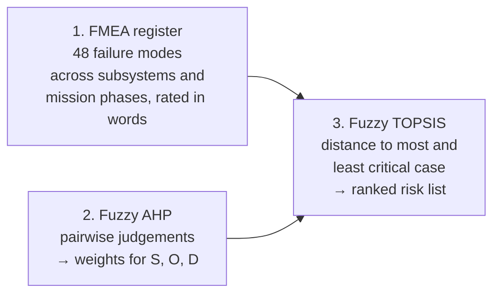

# CubeSat Risk Management Framework (CSRM)

A risk prioritisation framework for student CubeSat teams. It combines a
linguistic FMEA register, Fuzzy AHP and Fuzzy TOPSIS to rank failure modes when
there is little failure data and a lot of uncertainty in expert judgement.

Built as a five-person team project in the European Project Semester at
Glasgow Caledonian University (spring 2026), for Commercial Space Technologies Ltd.


## The problem

Around 40% of university CubeSats fail to meet their basic mission objectives,
and about a quarter never make contact after deployment (Swartwout, 2013).
Formal risk standards such as NASA NPR 8000.4 and ECSS-M-ST-80 assume
professional teams with reliability engineers and historical data. Student teams
have neither, and only about half use any risk management at all
(Monteiro et al., 2022).

The brief was to design a structured risk framework from first principles that
a student team can use with a spreadsheet and some basic Python.

## How it works



1. **Linguistic FMEA.** Each failure mode is rated for Severity, Occurrence and
   Detectability in words (for example *High* or *Difficult*), not numbers. The
   words are mapped to triangular fuzzy numbers, so the uncertainty is kept
   instead of hidden behind a precise-looking score.
2. **Fuzzy AHP** (Buckley's geometric mean). Three pairwise judgements decide how
   much each criterion counts. Result: Severity 0.675, Occurrence 0.201,
   Detectability 0.124, with a consistency ratio of 0.0948 (below the 0.10
   threshold).
3. **Fuzzy TOPSIS** (Chen, 2000). Each failure mode is measured against the most
   critical and the least critical possible case. The closeness coefficient (CC)
   runs from 0 to 1, and a higher CC means a higher priority.

## My role

Five people worked on the project. I was responsible for:

- the Fuzzy TOPSIS ranking
- the Python implementation
- framework validation
- project planning (WBS and Gantt)
- the mid-term and final reports

## Run it

Requires Python 3.10 or newer.

```bash
pip install -r requirements.txt
python -m csrm                                  # Fuzzy AHP weights + top 10 risks
python -m csrm --phase Commissioning            # rank one mission phase
python -m csrm --compare --top 0                # ranks under three weight scenarios
python -m csrm --top 0 --csv results.csv        # export the full ranking
pytest                                          # run the tests
```

## Results

Top 10 of 48 failure modes with the Fuzzy AHP weights. Failure modes with the
same ratings get the same CC and share a rank.

| Rank | ID | Failure mode | S / O / D | CC |
|---:|---|---|---|---:|
| 1 | FM-19 | Limited testing budget | Very High / High / Difficult | 0.779 |
| 2 | FM-01 | Radiation-induced degradation (battery) | Very High / Moderate / Difficult | 0.743 |
| 2 | FM-31 | Failure to establish first contact | Very High / Moderate / Difficult | 0.743 |
| 2 | FM-37 | Fault management misconfigured | Very High / Moderate / Difficult | 0.743 |
| 5 | FM-21 | Reduced redundancy | Very High / High / Easy | 0.735 |
| 5 | FM-41 | Bus over-voltage or under-voltage | Very High / High / Easy | 0.735 |
| 7 | FM-10 | Insufficient testing | High / Very High / Very Difficult | 0.726 |
| 8 | FM-15 | Inaccurate Cost Estimation | High / Very High / Difficult | 0.708 |
| 9 | FM-30 | Tumble rate too high for ADCS capture | Very High / Low / Difficult | 0.707 |
| 9 | FM-40 | Single-event upset in critical logic | Very High / Low / Difficult | 0.707 |

The top of the list is a mix of testing and resource risks and well-known
technical killers: power, first contact and radiation. That matches the student
CubeSat failure literature the project used (Swartwout, 2013;
Langer and Bouwmeester, 2016).

## Post-submission review

After submitting, I went back through the spreadsheets and the report and found
errors in the Fuzzy TOPSIS stage, which was my part of the project. The report in
[`report/`](report/) is left exactly as submitted. This repository contains the
corrected implementation.

**What was wrong**

- **The ranking was inverted.** The spreadsheet compared each failure mode with
  the column *minimum* as the ideal and computed CC = d⁻ / (d⁺ + d⁻). A high CC
  therefore meant *low* risk, but the report read it as high risk. Across the
  register, the spreadsheet's CC correlated at −0.92 with a simple weighted
  S/O/D score.
- **A blank cell became the #1 risk.** *Funding Delays* had no Severity values.
  The blanks were read as 0, and the inverted ranking put it at the top.
- **A normalisation formula referenced the wrong column.** The upper bound for
  Occurrence pointed to the lower bound, which produced invalid fuzzy numbers
  (upper < middle). The divisor was also left over from an earlier, smaller
  version of the sheet.
- **The data and the report drifted apart.** The decision matrix had 54 rows
  against 48 in the FMEA register (leftover test rows and a duplicate), some IDs
  and descriptions were swapped in the results table, and the method text
  described different reference points than the sheet actually used.
- **The sensitivity check was too small to show much.** It was run on 5 failure
  modes and reported a maximum shift of one rank. Across all 48, the ranks move a
  lot when the weights change. For example, *Knowledge loss* moves from 38th to
  9th with equal weights, and 28 failure modes move more than three places. The
  weights matter, which is a reason to choose them carefully.

**What I changed**

- I rebuilt the register from the FMEA sheet: one row per failure mode, clean
  IDs, and the original spreadsheet ID kept in `legacy_id` for traceability.
- I reimplemented Fuzzy TOPSIS in Python, with both reference points weighted
  the same way as the data, so CC = 1 means the worst rating on every criterion.
- I added tests, including one that checks that raising any rating never lowers
  a failure mode's priority. The submitted spreadsheet fails that check.
- The Fuzzy AHP stage was correct and is unchanged. The tests confirm it
  reproduces the report's weights and consistency ratio exactly.

**What I learned:** a spreadsheet that runs without errors can still be wrong.
A validation step that only checks that values fall in the expected range
(CC between 0 and 1) does not catch a result that points the wrong way. Small
property tests, such as "worse ratings give higher risk", would have caught
every one of these errors early.

## Repository structure

```
data/fmea_register.csv   48 failure modes with linguistic S/O/D ratings
csrm/fuzzy.py            triangular fuzzy numbers and rating scales
csrm/fuzzy_ahp.py        Fuzzy AHP weights (from the report's Appendix E)
csrm/fuzzy_topsis.py     Fuzzy TOPSIS ranking
csrm/__main__.py         command line interface
tests/                   pytest suite
report/                  final report as submitted
```

## Team

Mathieu Besson-Imbert, Selma Dyrlie Johnsen, Manvi Sarawanan, Zsanett Waldau and
Charlay Walker. Client: Andrew Paliwoda, Commercial Space Technologies Ltd.

## References

- Buckley, J. J. (1985). Fuzzy hierarchical analysis. *Fuzzy Sets and Systems*, 17(3).
- Chen, C.-T. (2000). Extensions of the TOPSIS for group decision-making under fuzzy environment. *Fuzzy Sets and Systems*, 114(1).
- Langer, M. and Bouwmeester, J. (2016). Reliability of CubeSats: statistical data, developers' beliefs and the way forward. *AIAA/USU Conference on Small Satellites*.
- Swartwout, M. (2013). The first one hundred CubeSats: a statistical look. *Journal of Small Satellites*, 2(2).

The full reference list is in the report.
